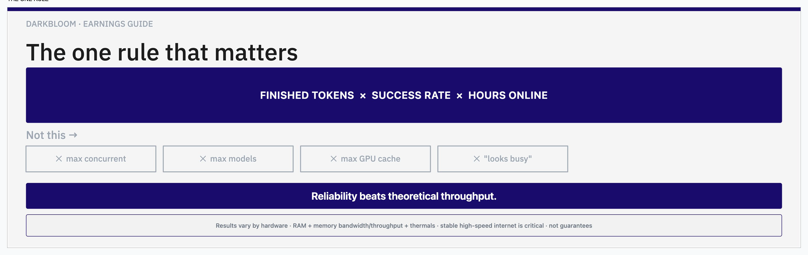
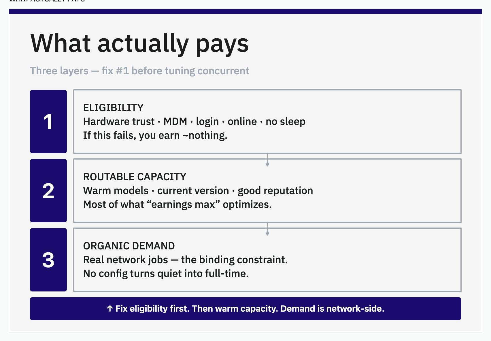
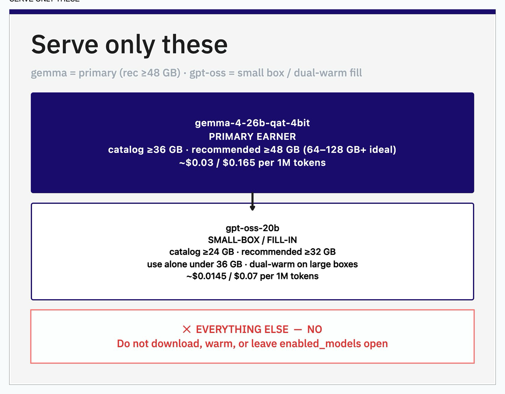
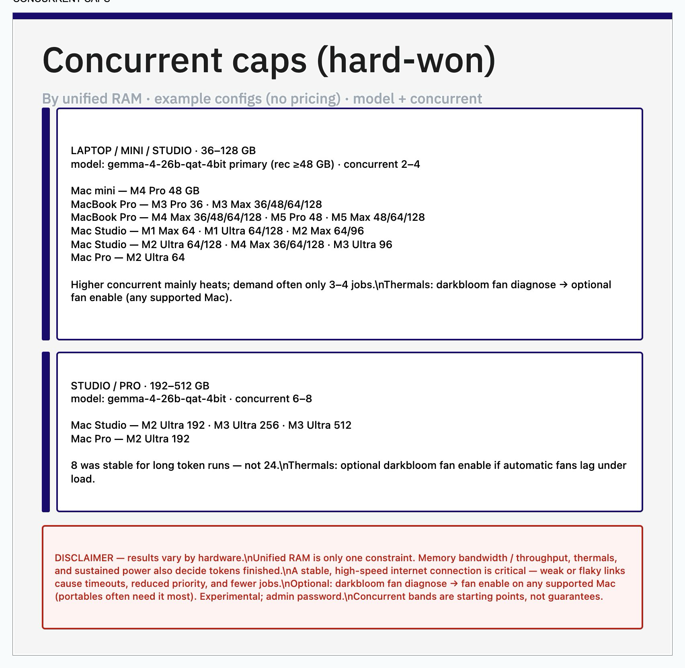
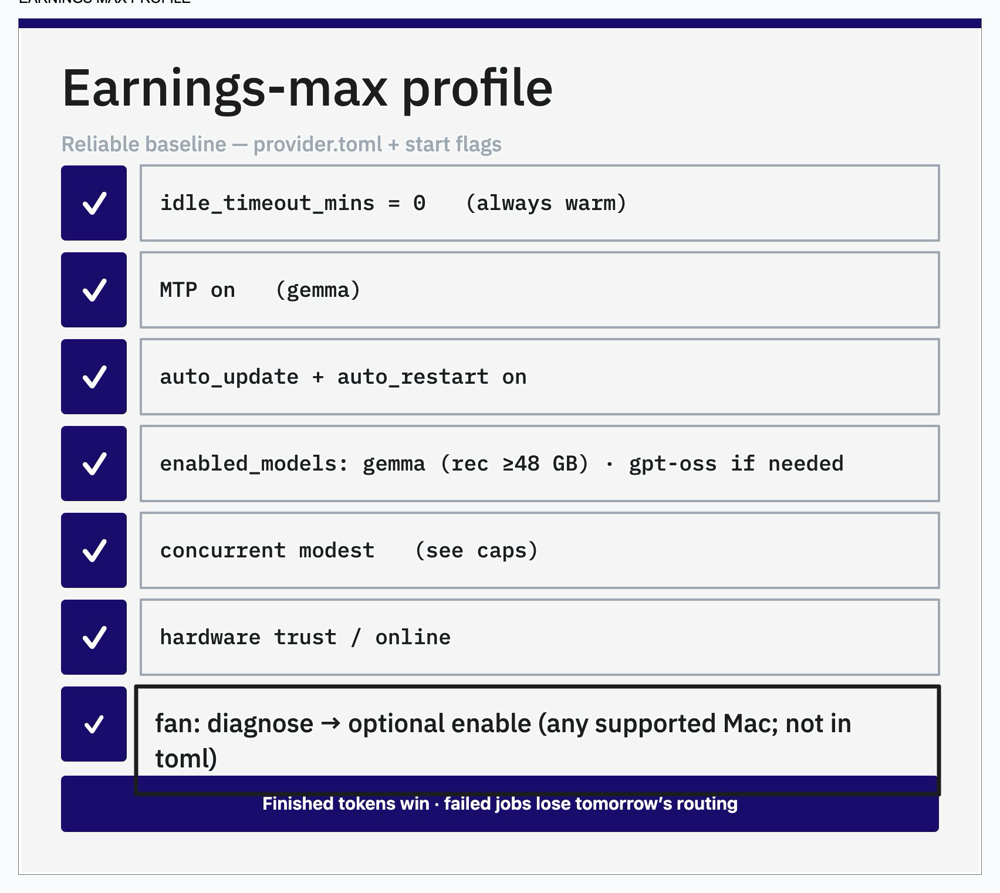
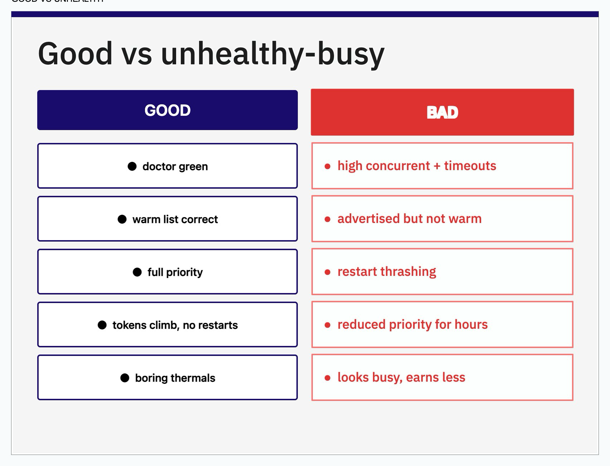
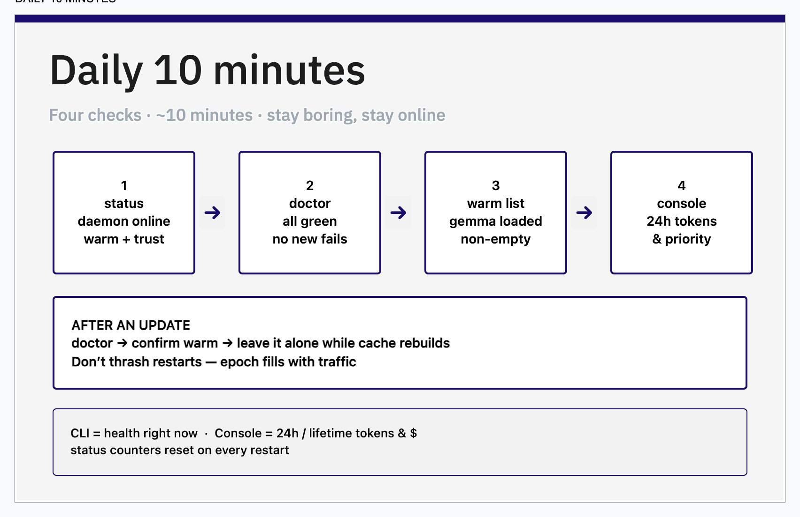

# Darkbloom Provider Guide

**Maximize finished tokens × success rate × hours online** — practical notes from running Apple Silicon providers in public alpha.

This repo is for other **Darkbloom providers** who already installed the CLI and want a clear, visual path to a reliable earnings setup. It is **not** official Darkbloom documentation.

| | |
|--|--|
| **Last verified** | 2026-07-22 · provider **0.7.12** |
| **Full guide** | [`guide.md`](./guide.md) |
| **For coding agents** | [`AGENTS.md`](./AGENTS.md) — point Claude / Cursor / Codex / Grok at this repo |
| **Source graphics** | [`assets/Darkbloom-Provider-Guide-Graphics.tldraw`](./assets/Darkbloom-Provider-Guide-Graphics.tldraw) |
| **Darkbloom** | [darkbloom.dev](https://www.darkbloom.dev/) · [console](https://console.darkbloom.dev/) · [install](https://api.darkbloom.dev/install.sh) |

---

## Disclaimer

**Independent advice.** Not affiliated with Darkbloom ([darkbloom.dev](https://www.darkbloom.dev/)) or Eigen Labs ([eigenlabs.org](https://www.eigenlabs.org/)). Not official documentation. Darkbloom / Eigen Labs names and marks belong to their owners. Use at your own risk.

**Results vary by hardware.** Unified RAM is only one constraint. Memory **bandwidth / throughput**, thermals, and sustained power also decide finished tokens. A **stable, high-speed internet connection is critical** — weak or flaky links cause timeouts, reduced priority, and fewer jobs.

Concurrent bands and model picks below are **starting points from one fleet’s experience**, not guarantees. Catalog mins and pricing change — always re-check:

```bash
darkbloom models catalog
darkbloom doctor
```

Public alpha software. Not financial advice. Demand and policy change.

---

## How to use this page

Cards are in **order**. Skim the graphic, read the short notes, move on. Deep detail lives in [`guide.md`](./guide.md).

**Using a local coding agent?** Open this repo (or paste the path) and tell it to follow [`AGENTS.md`](./AGENTS.md). Example:

```text
Read AGENTS.md and guide.md. Apply the earnings-max profile to this Mac:
run darkbloom status/doctor/catalog, then propose a minimal provider.toml change.
```

---

## 01 · The one rule



**Maximize finished tokens × success rate × hours online.**

Not max concurrent, not max models, not “looks busy.” The coordinator routes to machines that **finish cleanly**. Aggressive concurrent that causes deadlines usually earns **less**.

---

## 02 · What actually pays



Three layers — fix **#1** before tuning concurrent:

1. **Eligibility** — hardware trust, MDM, console login, online, no sleep  
2. **Routable capacity** — warm models, current version, good reputation  
3. **Organic demand** — real network jobs (the binding constraint)

No config turns a quiet network into full-time income.

**CLI vs console:** `darkbloom status` counters **reset on restart**. Console is 24h / lifetime truth.

---

## 03 · Serve only these



| Model | Role | Catalog min | Recommended |
|-------|------|-------------|-------------|
| **`gemma-4-26b-qat-4bit`** | Primary earner | ≥ **36 GB** | **≥ 48 GB** (64–128 GB+ ideal) |
| **`gpt-oss-20b`** | Small-box / fill-in | ≥ **24 GB** | **≥ 32 GB** · alone if under 36 GB · optional dual-warm on large boxes |

Do **not** invert this: gpt-oss is the smaller-RAM model; gemma is the better-paid workhorse when you clear ~36 GB.

Pin an allowlist — do not leave `enabled_models` empty with random weights on disk.

```bash
# ≥48 GB — gemma primary
darkbloom start --model gemma-4-26b-qat-4bit --idle-timeout 0 --local-endpoint

# 24–32 GB — gpt-oss only
darkbloom start --model gpt-oss-20b --idle-timeout 0 --local-endpoint
```

---

## 04 · Concurrent caps (hard-won)



Grouped by **unified RAM**, with example Mac configs (**no pricing**).

| Band | Model | Concurrent |
|------|--------|------------|
| **36–128 GB** | gemma primary (rec ≥48 GB) | **2–4** |
| **192–512 GB** | gemma | **6–8** |

Example families in the card: mini M4 Pro 48 · MBP M3/M4/M5 Max bands · Studio Max/Ultra · Mac Pro M2 Ultra · Studio M3 Ultra 256/512.

Higher concurrent mainly **heats**; demand often only 3–4 jobs on laptops. **8** was stable on large Studio-class boxes — not 24.

See [Disclaimer](#disclaimer): RAM alone is not enough; bandwidth + network matter.

---

## 05 · Earnings-max profile



Reliable baseline knobs:

- `idle_timeout_mins = 0` (always warm on dedicated earn boxes)  
- MTP **on** for gemma (`darkbloom beta enable mtp`)  
- `auto_update` + `auto_restart` **on**  
- `enabled_models` pinned (gemma and/or gpt-oss only)  
- concurrent modest (see §04)  
- hardware trust / online  

Example TOML: [`config/examples/provider-earnings-max.toml`](./config/examples/provider-earnings-max.toml)

---

## 06 · Good vs unhealthy-busy



| Good | Bad |
|------|-----|
| doctor green | high concurrent + timeouts |
| warm list correct | advertised but not warm |
| full priority | restart thrashing |
| tokens climb without restarts | reduced priority for hours |
| boring thermals | looks busy, earns less |

If priority drops: cut concurrent, stay warm, **wait** — don’t config-thrash.

---

## 07 · Daily 10 minutes



1. **status** — daemon online, warm + trust  
2. **doctor** — all green  
3. **warm list** — gemma (or your model) loaded  
4. **console** — 24h tokens & priority  

After an update: doctor → confirm warm → leave it alone while cache rebuilds. Don’t thrash restarts.

CLI = health **now**. Console = 24h / lifetime tokens & $.

---

## Quick commands

```bash
darkbloom status
darkbloom doctor
darkbloom verify
darkbloom update --check-only
darkbloom beta enable mtp
darkbloom restart
darkbloom models catalog
darkbloom models list
```

---

## Repo layout

```text
README.md                 ← this page (cards + short text)
guide.md                  ← full operator guide
AGENTS.md                 ← rules for coding agents pointed at this repo
assets/cards/01…07.png    ← exported panels
assets/*.tldraw           ← editable source board
config/examples/          ← sample provider.toml
```

---

## Contributing

Catalog mins, model IDs, and best concurrent settings shift in alpha. PRs welcome when you’ve **verified** a change with `darkbloom models catalog` / live traffic — not calculator vibes.

Please **do not** open issues asking for earnings predictions or hardware buy advice beyond what’s documented.

---

## License

MIT — see [LICENSE](./LICENSE). Content is independent provider notes, shared as-is. Not affiliated with Darkbloom or Eigen Labs.
